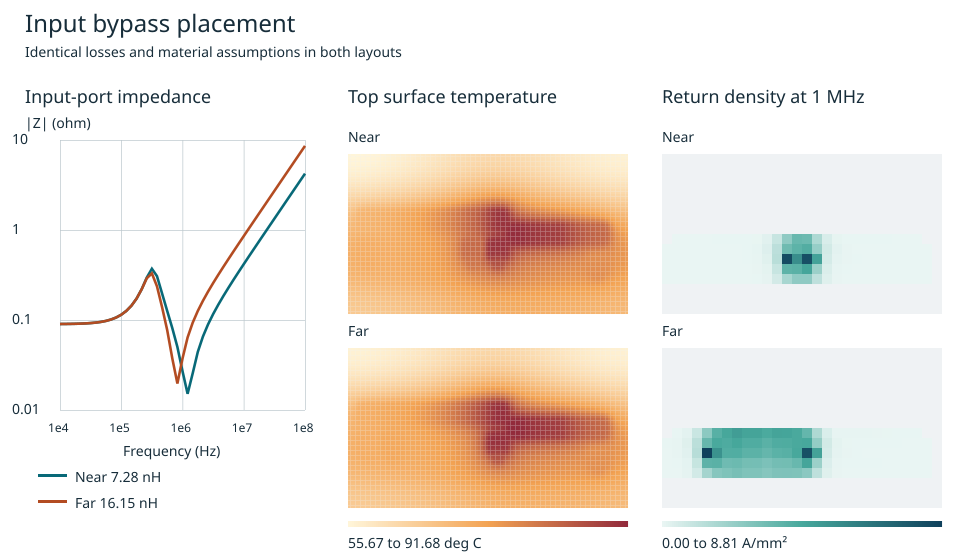

# KiCad PCB Physics

[日本語](README.md) | **English**

Calculate voltage drop, heat flow and power-port impedance from a filled KiCad board. An offline report overlays the results on individual copper layers. Layout and operating conditions are separate inputs, so the same load case can be applied to several revisions.

## Features and validation

| Study | What you can inspect | Validation status |
|---|---|---|
| Whole-board heat | Layer and package temperatures from device and copper losses. Specify air temperature, convection and package-to-air resistance. | **Validated on coupons** for steady conduction, energy balance and mesh refinement. Package contacts and cooling need experimental data. |
| Conductor resistance | Terminal voltage, via current, current density, DC loss and AC skin effect. | **Validated on coupons** against a uniform strip and a through-thickness diffusion solution. |
| Emission and pickup | Near fields, small-loop radiation and received voltage for prescribed incident fields and harness terminations. | **Experimental** for a populated board. Elementary source and receiving contours have analytic checks. |
| Reference-plane current | Frequency-dependent return spread, plane voltage and reference gaps beneath a trace. | **Experimental** for real planes. Two-foil current division has a closed-form check. |
| Power distribution | Mounted capacitor loops, coupled branch impedance, bias-dependent capacitance and ripple from a periodic current waveform. | **Validated** for the passive network against ngspice. Extraction of installed inductance is **experimental**. |
| Transmission lines | Ordered trace, barrel and package lengths, propagation, skew, spatial cross sections and single-ended/mixed-mode Touchstone files. | **Validated on uniform coupons** for quasi-static impedance and network conversion. Slot, loss and launch predictions are **experimental**. |
| Ground stitch placement | Rank legal sites by incremental resistance, plane voltage, modeled loop inductance or ground-contact deficit. Export overlays, rankings and an optional new board copy. | **Validated on resistive and inductive coupons**. Real-board loop fields, neck scoring and predicted marginal gains are **experimental**. |

[Coupon geometries, errors and tolerances](VALIDATION.md)

## Install and run

Use Python 3.10 or later and KiCad with the pcbnew Python bindings. Set `KICAD_PYTHON` to the interpreter that can import pcbnew. For independent circuit verification install ngspice and place it on the search path, or set `NGSPICE_BIN`. Without ngspice one integration test is skipped. LTspice is an optional separate installation.

```sh
python3 -m venv .venv
. .venv/bin/activate
python -m pip install .
python -m unittest discover -s tests
"${KICAD_PYTHON:-python3}" examples/generate_buck.py output/buck
for layout in near far; do
  d="output/buck/$layout"
  pcb-physics "$d/coupon.kicad_pcb" "$d/settings.json" "$d/result"
done
python examples/plot_buck.py output/buck output/comparison.svg
```

For your own board use `pcb-physics BOARD.kicad_pcb CONDITIONS.json OUTPUT`. Open `index.html` in that output folder, keeping `data.js` beside it. Inspect `results.json`, `impedance.csv` and `provenance.json` for numerical results and input hashes. The generator in [examples/generate.py](examples/generate.py) illustrates additional analyses, including local transient templates and simulator parameters. [Study settings](STUDIES.md)

## Example output

The fictitious buck coupon has a half bridge, winding, output reservoir and an input bypass connected through a bottom return strip. Only the input bypass and its return fanout move. Under the same 1 MHz, 1 A return excitation, moving the bypass from 10.5 to 2.5 mm from the input pin reduces the RMS return spread from 2.67 to 1.64 mm. The extracted loop term falls from 16.15 to 7.28 nH. With the specified steady losses, the predicted board peaks are 91.68 and 91.23 °C. The paired thermal and current maps share their respective scales.

The second generator, `examples/generate_pair.py`, builds a nominal 90 Ω pair with a deliberate jog and a split in the reference plane. It also includes a two-foil via-placement study. Use the same command with its `pair.kicad_pcb` and `settings.json`. The HTML links to the Touchstone files, selected via coordinates and per-step rankings.



## Scope and limits

Use filled zones and refine the mesh at narrow tracks, slots and via transitions. Clipping a plane changes its return path. The symmetric skin model omits proximity loss and copper roughness. High-frequency fields depend on the assumed return contour, excitation and enclosure. Thermal mesh convergence applies to the specified materials and cooling boundaries. Validate package temperatures, absolute emissions and ringing on hardware. The generated reports and geometry caches contain recoverable board geometry.

## License

Original code and example artwork are distributed under the [MIT license](LICENSE). External solvers and libraries retain their own [licenses](DEPENDENCIES.md).
