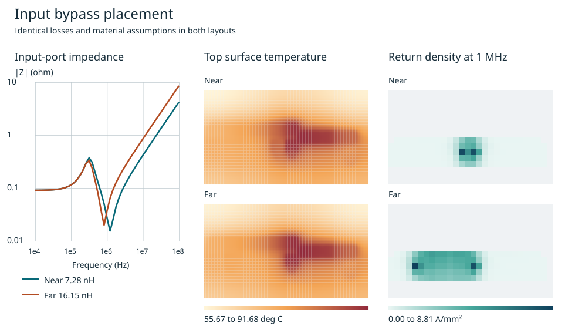

# KiCad PCB Physics

ゾーンを充填したKiCad基板から電圧降下、発熱、電源端子のインピーダンスを計算します。ローカルのHTMLで層を切り替え、銅箔に分布を重ねて表示できます。基板と負荷・材料の条件を別ファイルに指定するので、同じ条件で改訂前後を比較できます。[English](README.md)

## 5つの機能と検証状態

| 解析 | 確認できること | 検証状態 |
|---|---|---|
| 全板熱 | 部品損失と銅損から全層・部品の定常温度を求める。気温・対流係数・放熱片経由の熱抵抗を指定できる。 | 熱伝導・収支・格子収束は試験片で**検証済み**。接触熱抵抗と風量は実機の条件が必要。 |
| 配線抵抗 | 2点間抵抗、端子電圧、ビア電流、電流密度、表皮効果による交流抵抗の増加。 | 一様導体の直流抵抗と厚さ方向の拡散解で**検証済み**。 |
| 放射・受信 | 近傍界、微小ループの放射、外来電磁界やハーネスから誘起される端子電圧。 | 実基板への適用は**実験的**。単純な放射源・受信ループを解析解と照合。 |
| 基準面の戻り電流 | 周波数別の電流の広がり、面内電位、配線直下で基準面が途切れる場所。 | 実基板の推定は**実験的**。2枚の箔の電流分担を解析解と照合。 |
| 電源インピーダンス | コンデンサーまでの往復配線、相互結合、実効容量、ESR、ESLを含めた周波数特性と電流波形に対するリップル。 | 受動回路の数値解はngspiceで**検証済み**。実装インダクタンス抽出は**実験的**。 |
| 伝送線路・差動ペア | 線路・ビア・指定パッケージの長さ、遅延、スキュー、位置ごとの断面インピーダンス、単端・混合モードのTouchstone出力。 | 一様断面とモード変換を試験片で検証。スリット、減衰、実装部の応答は実験的。 |
| GNDビア配置 | 候補位置の間隔を検査し、抵抗・電位差・ループインダクタンス・銅箔への接続の改善量を1本ずつ再計算。重ね表示、CSV、指定時の別名基板を出力。 | 単純なビア群で抵抗とインダクタンスを検証。実基板の高周波帰路、細首の判定、微小な改善量は実験的。 |

[検証に使った形状と誤差](VALIDATION.md)

## 導入と実行

Python 3.10以降、pcbnewを使えるKiCadが必要です。`KICAD_PYTHON` にpcbnewを読み込めるPythonを指定します。回路照合に使うngspiceはPATHに置くか、`NGSPICE_BIN` に指定してください。ngspiceがない環境では結合テスト1件がスキップされます。LTspiceも別途設定できます。

```sh
python3 -m venv .venv
. .venv/bin/activate
python -m pip install .
python -m unittest discover -s tests
"${KICAD_PYTHON:-python3}" examples/generate_buck.py output/buck
for layout in near far; do
  d="output/buck/$layout"
  pcb-physics "$d/coupon.kicad_pcb" "$d/settings.json" "$d/result"
done
python examples/plot_buck.py output/buck output/comparison.svg
```

任意の基板には `pcb-physics BOARD.kicad_pcb CONDITIONS.json OUTPUT` を使います。出力した `index.html` をブラウザーで開き、同じ場所に `data.js` を置いてください。数値は `results.json` と `impedance.csv`、入力ハッシュは `provenance.json` にあります。追加の電磁界・回路解析条件は[設定の説明](STUDIES.md)と[試験片の生成例](examples/generate.py)にあります。

## 出力例

架空の降圧回路にハーフブリッジ、コイル、出力コンデンサーと裏面の帰路を設け、入力コンデンサーとその帰路の引き出しを移動しました。入力ピンまでの距離を10.5 mmから2.5 mmに縮めると、抽出ループ項は16.15から7.28 nH、1 MHz・1 Aの戻り電流の実効的な広がりは2.67から1.64 mmに変わりました。同一損失での基板最高温度は91.68 ℃と91.23 ℃です。温度図同士と電流密度図同士はそれぞれ同じ色尺度で比較できます。

追加の作例 `examples/generate_pair.py` は、90 Ωを狙った差動ペアに蛇行と基準プレーンのスリットを設け、2層のGNDビア候補も比較します。生成した `pair.kicad_pcb` と `settings.json` を同じコマンドに渡すと、HTMLでの重ね表示、Touchstoneファイル、座標と改善量のCSVを確認できます。



## 適用範囲と限界

狭い配線、スリット、ビア付近は格子を細かくして比較してください。基準面の切り出し境界は帰路を変えます。表皮効果のモデルでは近接効果と表面粗さを省略しています。電磁界・放射は帰路、励振、筐体に依存し、熱解析は入力した損失と冷却条件に依存します。接合温度・放射の絶対値・リンギングは試作で確認してください。出力HTMLの付属データと形状キャッシュから基板形状を復元できます。

## ライセンス

コードと作例の図は[MITライセンス](LICENSE)です。依存ライブラリー・別途実行するソルバーの条件は[ライセンス一覧](DEPENDENCIES.md)に記載しています。
